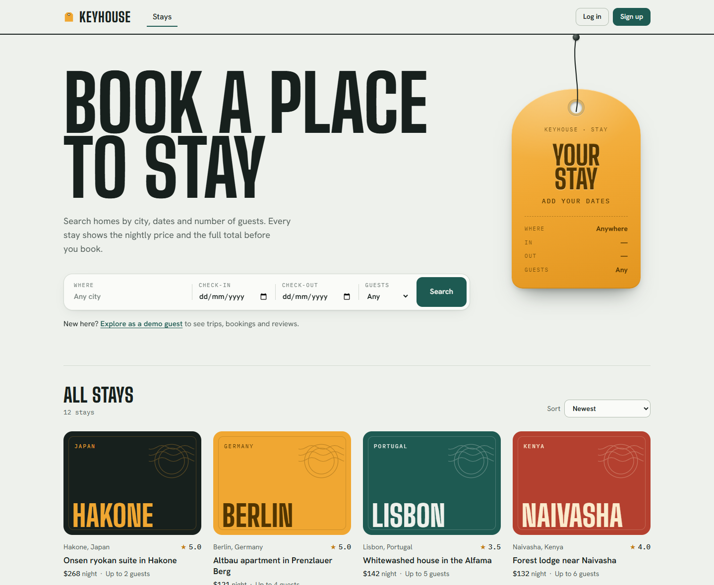
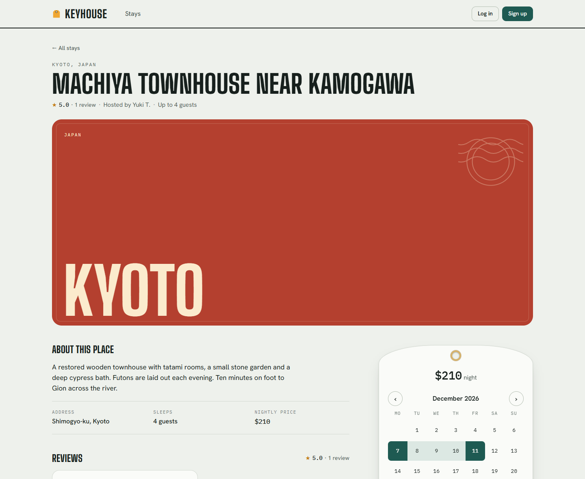
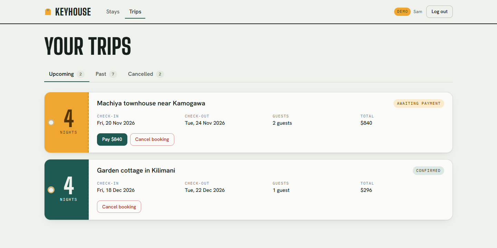
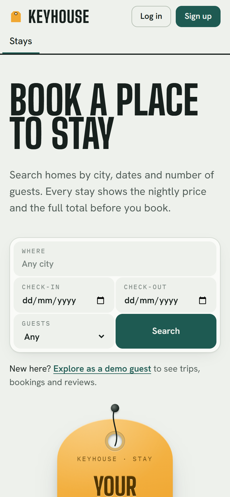

# Keyhouse: a full-stack Airbnb-style booking app

Search places to stay, book dates on an availability calendar, pay with Stripe, and review your stay. Hosts list homes, upload photos and manage bookings. Built with **Django REST Framework** and **React + TypeScript**, tested on MySQL and PostgreSQL, and deployed on Render.

**[Live demo → keyhouse.onrender.com](https://keyhouse.onrender.com)**

On the login page, choose **Explore as a guest** or **Explore as a host** to look around without signing up. To try paying, use Stripe's test card `4242 4242 4242 4242` with any future date and any CVC.

> The demo runs on a free plan that sleeps when nobody is using it, so the first visit can take up to a minute to load.



## What it does

- **Search and browse.** Filter by city, dates, guests and price; sort by price or rating. Choosing dates hides places that are already booked.
- **Book.** Pick dates on a calendar that crosses out booked nights, see the full price breakdown, and reserve.
- **Pay.** Stripe Checkout takes the payment and a webhook confirms the booking. Cancelling a paid booking refunds it.
- **Review.** Guests rate and review a stay after checking out. Listings show their average rating.
- **Host.** List a place, upload photos, and confirm or decline bookings.

| A stay, with its availability calendar | Trips: each booking is a luggage tag |
|---|---|
|  |  |

<p align="center"></p>

## Engineering highlights

- **No double bookings, even under load.** Creating a booking locks the listing's row (`SELECT … FOR UPDATE`) while it checks for overlaps, so two people booking the same dates at the same moment can't both succeed. See [`apps/bookings/services.py`](apps/bookings/services.py).
- **Payments that fail safely.** Stripe webhooks are signature-verified and safe to receive twice. A failed refund rolls back the cancellation, so a guest is never left cancelled *and* charged. Late payments for released dates are refunded rather than double-booked. See [`apps/payments/services.py`](apps/payments/services.py).
- **Unpaid reservations release themselves.** A reservation left unpaid for an hour stops blocking dates without needing a background job, which keeps hosting simple and cheap. See [`apps/bookings/models.py`](apps/bookings/models.py).
- **Security by default.** JWT auth with automatic token refresh, rate limits, role-based permissions (only hosts list places; only owners edit them), public profiles that never expose email addresses, read-only shared demo accounts, and production settings verified by `manage.py check --deploy` in CI.
- **Tested.** Around 120 pytest tests (about 95% coverage) run in GitHub Actions against **both MySQL and PostgreSQL**, alongside linting, a missing-migrations check and a type-checked frontend build.
- **One deployable unit.** A multi-stage Docker build compiles the React app, and Django serves it with the API on one domain, so there's no cross-origin setup. Deploys from a Render Blueprint.
- **A considered UI.** A custom date-range calendar, keyboard-accessible controls, reduced-motion support, responsive layouts down to phone width, and a visual identity built around an old hotel key tag.

## Tech stack

| Layer | Tools |
|---|---|
| Backend | Python 3.13, Django 5.2, Django REST Framework, SimpleJWT, django-filter, drf-spectacular (OpenAPI) |
| Frontend | React 19, TypeScript, React Router, TanStack Query, Vite; plain CSS with design tokens |
| Data | PostgreSQL (production) or MySQL; SQLite for quick local development |
| Payments | Stripe Checkout and webhooks |
| Infrastructure | Docker, Gunicorn, WhiteNoise, GitHub Actions, Render (Railway also supported) |

## How it fits together

```
 Browser ──▶ Django (Gunicorn)
              ├─ /           React app (built by Vite, served by WhiteNoise)
              ├─ /api/...    REST API ───────────────▶ Stripe Checkout
              ├─ /api/docs/  Swagger UI                     │
              └─ /admin/     Django admin                   │ webhook
                    │                                       ▼
                    ▼                          /api/payments/webhook/
              PostgreSQL / MySQL
```

Django apps: `users` (email login, guest/host roles, demo accounts), `properties` (listings, photos, search), `bookings` (reservations and availability), `reviews`, and `payments` (Stripe).

## Run it locally

You need Python 3.13+ and Node.js 22+.

```bash
# Backend: http://127.0.0.1:8000
python -m venv .venv
# Windows: .venv\Scripts\activate   |   macOS/Linux: source .venv/bin/activate
pip install -r requirements/dev.txt
cp .env.example .env              # then set SECRET_KEY to any long random string
python manage.py migrate
python manage.py seed_demo        # 12 listings, demo hosts and guests, past stays and reviews
python manage.py runserver

# Frontend: http://localhost:3000 (in a second terminal)
cd frontend
npm install
npm run dev
```

Demo accounts: `guest@demo.keyhouse.test` and `amara@demo.keyhouse.test` (host), password `Keyhouse-demo-2026`, or use the **Explore as…** buttons on the login page. For MySQL in Docker instead of SQLite, run `docker compose up --build`.

### Checks

```bash
sh scripts/check.sh      # everything CI runs: lint, migrations, tests, production settings, frontend build
pytest --cov=apps        # backend tests with a coverage report
```

## Documentation

- [API reference](docs/api.md): endpoints, filters, booking rules, and testing payments locally. Interactive docs are at `/api/docs/`.
- [Deploying to Render](docs/deploy-render.md) (the live demo) and [deploying to Railway](docs/deploy-railway.md)
- [Original project plan](docs/project-plan.md): the design document written before any code, covering goals, roles, database design and security plans

## Project structure

```
apps/            Django apps: users, properties, bookings, reviews, payments
config/          Settings, URLs, health check, SPA view
frontend/        React + TypeScript app
docs/            Guides, API reference, screenshots, original plan
scripts/         Container start script (migrate, create admin, seed, Gunicorn)
Dockerfile       Builds the frontend, then the Django image
render.yaml      Render Blueprint (web service + PostgreSQL)
```
